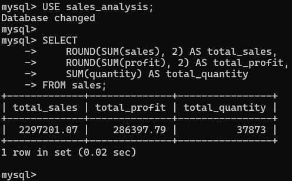
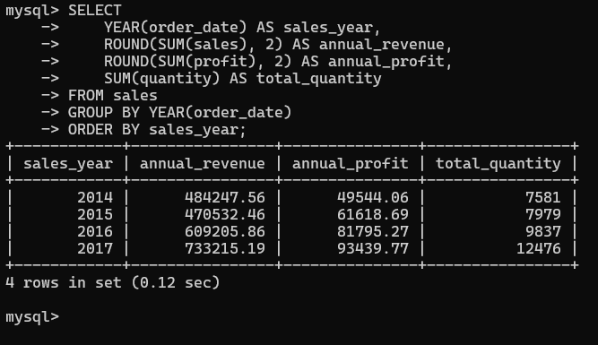
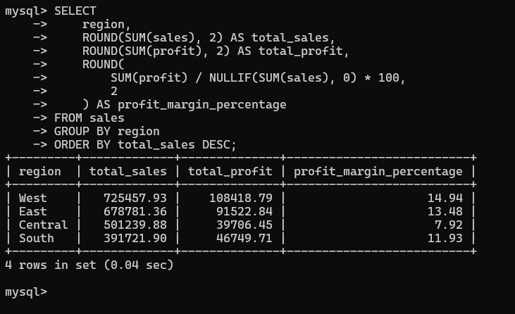
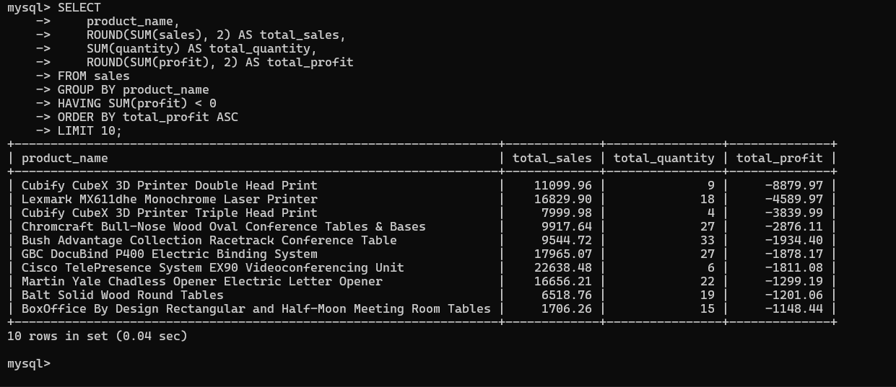

# Sales Analysis Using SQL

## Project Overview

This project analyzes the Sample Superstore sales dataset using MySQL to identify sales trends, profitable products, customer segment performance, and regional opportunities.

## Objectives

- Analyze overall sales, profit, and quantity sold.
- Identify top-selling and loss-making products.
- Analyze monthly and yearly revenue trends.
- Compare regional and customer segment performance.
- Evaluate profitability across discount levels and shipping modes.
- Develop data-driven business recommendations.

## Tools and Technologies

- MySQL Server 8.0
- MySQL Command Line Client
- SQL
- Visual Studio Code
- Git and GitHub

## Dataset

- Dataset: Sample Superstore
- Imported records: 9,994
- Date range: January 3, 2014 – December 30, 2017
- Key fields: Order Date, Ship Date, Region, Product Name, Sales, Quantity, Discount, and Profit

## SQL Skills Demonstrated

- SELECT, WHERE, GROUP BY, and ORDER BY
- Aggregate functions: SUM, COUNT, MIN, and MAX
- HAVING and LIMIT
- Date functions: YEAR, MONTH, and STR_TO_DATE
- Conditional aggregation and NULL checks
- Profit margin calculations
- Business KPI analysis

## Key Findings

- The West region generated the highest sales and profit among the four regions.
- Consumer customers contributed the largest share of revenue.
- Home Office had the highest profit margin among the three customer segments.
- November 2017 was the highest-revenue month in the results analyzed.
- Copiers were the most profitable subcategory in the query results.
- Some products and high-discount groups recorded negative total profit.

## Data Quality

The imported table contains 9,994 records. Initial checks found no missing values in the selected date, sales, profit, and quantity fields.

The import generated warnings that require further investigation before the dataset can be considered fully validated.

## Project Structure

```text
sales-analysis-using-sql/
├── data/
│   └── Sample-Superstore.csv
├── sql/
│   └── sales_analysis.sql
├── screenshots/
└── README.md
```

## Business Recommendations

- Investigate products with persistent negative profit.
- Review high-discount transactions and their effect on margins.
- Study the Central region's lower profit margin.
- Explore opportunities to grow the Home Office segment.
- Monitor monthly revenue and profit trends.

## Conclusion

This project demonstrates how SQL can transform raw sales records into useful business insights for sales performance monitoring and decision-making.

## Author

Add your name and GitHub profile here.


## Project Screenshots

# Sales Analysis Using SQL

A data analytics project using **MySQL** to analyze sales performance, profitability, regional trends, product performance, customer segments, and discount impact using the Sample Superstore dataset.

## Project Overview

This project analyzes historical retail sales data to identify business trends, evaluate profitability, and uncover opportunities to improve sales performance. SQL queries are used to transform raw transaction data into meaningful business insights that support data-driven decision-making.

## Objectives

- Analyze overall sales, profit, quantity, and profit margin.
- Identify yearly and monthly sales trends.
- Compare sales and profitability across regions.
- Identify top-performing and loss-making products.
- Evaluate customer segment and shipping mode performance.
- Understand how discounts affect profitability.
- Perform basic data-quality checks.

## Tools and Technologies

- **Database:** MySQL 8.0
- **Query Language:** SQL
- **Development Environment:** VS Code and MySQL Command Line Client
- **Version Control:** Git and GitHub
- **Dataset:** Sample Superstore sales data

## Dataset Overview

The dataset contains **9,994 records** of retail transactions, covering 2014–2017.

Key columns include:

- `Order Date`, `Ship Date`, `Order ID`
- `Customer Name`, `Segment`, `Region`
- `Category`, `Sub-Category`, `Product Name`
- `Sales`, `Quantity`, `Discount`, `Profit`

## SQL Skills Demonstrated

- SELECT, WHERE, GROUP BY, and ORDER BY
- Aggregate functions: SUM, COUNT, and ROUND
- Date functions and monthly/yearly analysis
- Filtering aggregated results using HAVING
- NULL handling using NULLIF
- Profit margin calculations
- Ranking and limiting query results
- Data-quality checks

## Key Findings

The following findings are based on the current SQL query results.

| Metric | Result |
|---|---:|
| Total records | 9,994 |
| Total sales | $2,297,201.07 |
| Total profit | $286,397.79 |
| Total quantity sold | 37,873 |
| Overall profit margin | 12.47% |
| Analysis period | 2014–2017 |

### 1. Yearly Sales Performance

- 2017 recorded the highest sales, at approximately **$733,215.91**.
- Sales increased from approximately $484,247.56 in 2014 to $733,215.91 in 2017.
- Both sales and profit increased over the analyzed period.

### 2. Regional Performance

- **West:** Highest sales and profit, with approximately $725,457.93 in sales and $108,418.79 in profit.
- **East:** Second-highest sales, at approximately $678,781.36.
- **Central:** Lowest profit margin among the four regions, at approximately 7.92%.
- **South:** Lowest sales, at approximately $391,721.90.

### 3. Product Profitability

- **Copiers** generated the highest sub-category profit, at approximately $55,617.90.
- Phones and Accessories were also strong contributors to profit.
- Tables, Supplies, and Bookcases recorded negative total profit.

### 4. Discount Impact

- Transactions with a 0% discount generated approximately $320,987.88 in profit.
- Discounts of 30%, 40%, 50%, 70%, and 80% were associated with negative aggregate profit in the analyzed data.
- The 70% discount group recorded approximately $40,075.46 in losses.

These findings show an association between higher discount levels and losses in this dataset; they do not, by themselves, establish causation.

### 5. Customer Segments

- Consumer generated the highest sales, at approximately $1,161,401.34.
- Home Office had the highest profit margin among the three segments, at approximately 14.03%.
- Corporate had a profit margin of approximately 13.03%.

## Business Insights and Recommendations

1. **Improve regional profitability:** Investigate the Central region's lower profit margin and identify opportunities to optimize pricing, product mix, and operating costs.

2. **Review discount policies:** Evaluate high-discount transactions carefully and introduce margin-based discount limits where appropriate.

3. **Manage loss-making products:** Investigate the pricing, shipping costs, discounts, and demand for products with recurring losses.

4. **Prioritize profitable products:** Review inventory and marketing opportunities for strong contributors such as Copiers, Phones, and Accessories.

5. **Learn from high-performing segments:** Study the purchasing behavior and profitability of the Home Office segment to identify opportunities for targeted campaigns.

6. **Monitor performance regularly:** Use monthly and yearly sales and profit metrics to detect declining performance and track improvements.

## Project Screenshots

### Sales KPIs



### Yearly Sales Analysis



### Regional Performance



### Loss-Making Products



## Project Structure

```text
sales-analysis-using-sql/
├── data/
│   └── Sample-Superstore.csv
├── sql/
│   └── sales_analysis.sql
├── screenshots/
│   ├── sales-kpis.png
│   ├── yearly-sales.png
│   ├── regional-analysis.png
│   └── loss-products.png
├── .gitignore
└── README.md
```

## How to Run the Project

1. Install MySQL Server 8.0 or a compatible MySQL version.
2. Create the `sales_analysis` database.
3. Import the Sample Superstore CSV into the `sales` table using the table structure defined for this project.
4. Open `sql/sales_analysis.sql`.
5. Execute the queries in MySQL to reproduce the analysis.

## Data Quality Note

Basic checks found no missing values in the selected fields checked. The CSV import also generated MySQL warnings, so the import warnings and data encoding should be investigated before treating all results as fully validated.

## Conclusion

This project demonstrates how SQL can be used to analyze retail data, calculate business KPIs, identify profitability issues, and communicate actionable insights. It showcases practical database querying and analytical skills relevant to entry-level Data Analyst roles.

## Author

**Thiruvaipati Chiranjeevi Amarnath**

Aspiring Data Analyst | SQL | Python | Excel | Power BI

GitHub: [Amarnath-data](https://github.com/Amarnath-data)
